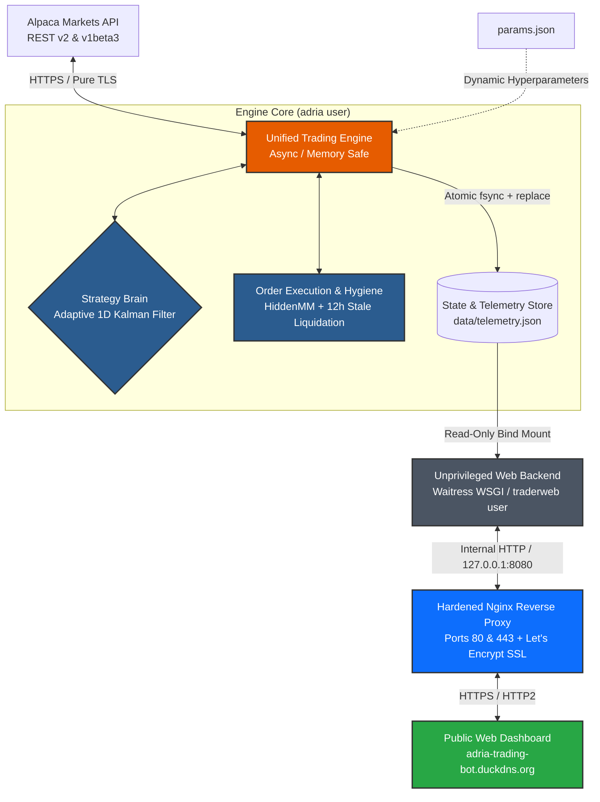
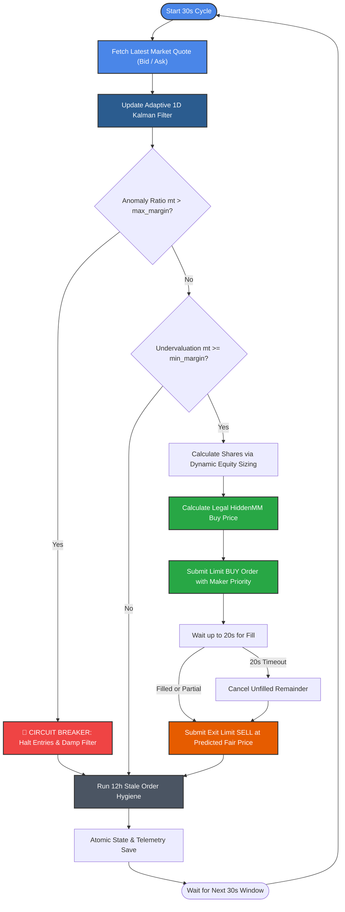
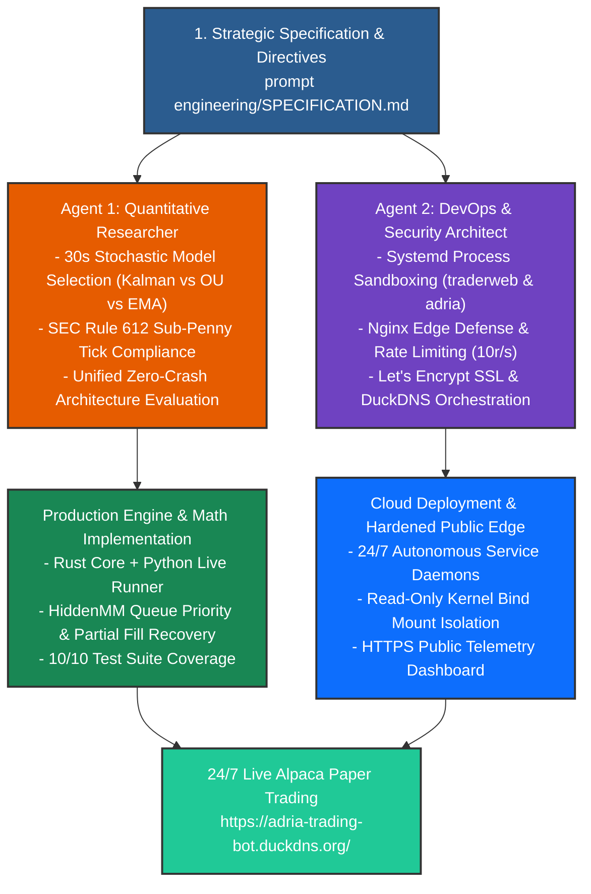

# Mean Reversion Trading System with Adaptive Kalman Filtering & Asymptotic Capital Allocation (v2.0)

<div align="center">

[](https://adria-trading-bot.duckdns.org/)

</div>

> ### 🌐 Live Quantitative Dashboard (Real-Time Telemetry)
> **Access the live, autonomous trading bot operating 24/7 on Alpaca Paper Trading:**  
> 👉 **[https://adria-trading-bot.duckdns.org/](https://adria-trading-bot.duckdns.org/)**  
> *(Publicly accessible without credentials. Fully responsive on desktop, tablet, and mobile with SSL/TLS encryption).*

---

## 🏗 System Architecture

The v2.0 system follows a strict "Separation of Concerns" principle to maximize runtime resilience, eliminate IPC fragility, and guarantee zero crashes.



---

## 🔧 Core Components

* **Unified Trading Engine (Rust 2021 + Tokio):**
  * Consolidates execution and strategy into a single native binary, eliminating Linux pipes, `SIGPIPE` crashes, serialization overhead, and buffer overflow risks.
  * Employs compile-time memory safety, strict non-blocking async I/O (`reqwest` with pure `rustls`), and atomic file checkpointing (`fsync`).
* **Strategy Brain (Adaptive 1D Kalman Filter):**
  * State-space latent fair-price estimator replacing fixed-alpha EMAs.
  * Microstructure-adaptive measurement variance $R_t$ dynamically filters out bid-ask bounce noise.
  * Myers-Tapley innovation variance tracking dynamically collapses lag during genuine price trends.
* **Execution & Hygiene Manager ("HiddenMM"):**
  * **Maker Queue Priority:** Places limit BUY orders at Best Bid + $0.01 when spread $\ge 2$ ticks, capturing top queue priority without crossing the ask.
  * **20-Second Timeout:** Cancels remaining unfilled shares after 20 seconds, preventing stale order lockup.
  * **Partial Fill Recovery:** Tracks partial executions and immediately submits an exit limit SELL order at the predicted fair price for the exact filled quantity.
  * **12-Hour Stale Liquidation:** Checks open orders continuously; any order open $> 12$ hours is canceled and liquidated at market price.
* **Analytics Dashboard (Python 3 + NumPy):**
  * Reads real-time telemetry snapshots without exposing network ports to the public internet.
  * Calculates **Sharpe Ratio**, **Max Drawdown**, **Volatility**, **Win Rate**, and **P&L** on historical and live trades.
  * Bound strictly to `127.0.0.1:8080`.

---

## 🧠 Decision Algorithm & Capital Allocation

### 1. Market Cycle & Anomaly Detection (Every 30 Seconds)

Every 30 seconds, the engine queries the latest National Best Bid and Offer (NBBO) quote $(B_t, A_t)$, computes mid-price $z_t = \frac{1}{2}(B_t + A_t)$, and updates the Kalman state:

1. **Prior Prediction:** $\hat{x}_{t|t-1} = \hat{x}_{t-1|t-1}, \quad P_{t|t-1} = P_{t-1|t-1} + Q_{t-1}$
2. **Spread-Adaptive Measurement Noise:** $R_t = r_{\text{base}} \cdot z_t^2 + \gamma_s \left(\frac{A_t - B_t}{2}\right)^2$
3. **Innovation & Mispricing Ratio:** $\nu_t = z_t - \hat{x}_{t|t-1}, \quad m_t = \frac{\hat{x}_{t|t-1} - z_t}{\hat{x}_{t|t-1}}$

### 2. Thresholding & Circuit Breaker

* **Buy Signal:** Triggered when $m_t \ge m_{\min}$ (where $m_{\min}$ is `min_margin`, undervaluation anomaly detected).
* **Circuit Breaker / Volatility Ceiling (`max_margin`):** If $m_t > m_{\max}$ (where $m_{\max}$ is `max_margin`, e.g., flash crash or news dump), **trading halts immediately**. The state update is heavily gated to prevent poisoning the filter with extreme anomalies.

### 3. Dynamic Position Sizing & Portfolio Equity Allocation

Instead of arbitrary fixed share lots, capital allocation scales dynamically as a proportion of total portfolio equity $W_t$, governed by the normalized anomaly factor and execution liquidity constraints:

$$\text{Factor}(x) = 1 - \left(1 - x^{\text{level}}\right)^{\frac{1}{\text{level}}}$$

$$\text{Target Capital} = \text{Factor}(x) \times (W_t \times S)$$

$$\text{Allocated Capital} = \min(\text{Target Capital}, \; \text{Available Cash})$$

$$\text{Shares / Units} = \mathrm{round}\left(\frac{\text{Allocated Capital}}{P_{\text{buy}}}, \; 4\right)$$

*Where:*
* $x$: Normalized deviation ratio scaled between `min_margin` ($m_{\min}$) and `max_margin` ($m_{\max}$): $x = \mathrm{clamp}\left(\frac{m_t - m_{\min}}{m_{\max} - m_{\min}},\, 0,\, 1\right)$.
* $S$: Maximum equity proportion parameter (`max_shares` $\in (0, 1.0]$). For example, $S = 0.20$ limits any single trade to at most 20% of total portfolio equity, while $S = 1.0$ authorizes up to 100% of available capital when no other positions are active.
* $W_t$: Real-time portfolio equity reported by Alpaca (`client.get_account().equity`).
* $\text{Available Cash}$: Cash currently idle in the account. To prevent unphysical asymptotic lockups, if remaining cash is less than the calculated target capital, the algorithm directly deploys all available remaining cash: $\min(\text{Target Capital}, \; \text{Cash})$.
* Fractional crypto support: Solana (`SOL/USD`) is sized with 4 decimal places of precision (`round(qty, 4)`).

---

### 4. Empirical Anomaly Calibration & 3-Hour Profit Optimization

To determine the mathematically optimal value for `max_shares` ($S$), the live production environment on the GCP remote server (`35.239.201.102`) was calibrated using historical systemd execution logs:

* **Production Observation Sample:** $N_{\text{cycles}} = 484$ consecutive 30-second cycles ($4.03$ hours).
* **Empirical Anomaly Count:** $N_{\text{anomalies}} = 50$ market hunt undervaluation anomalies detected.
* **Anomaly Probability per Cycle:** $p = \frac{50}{484} = 0.10331$ ($10.33\%$ per 30s cycle, recurring once every $9.68$ cycles $\approx 290.4$s $\approx 4.84$ min).
* **Maker Order Fill Rate (20s timeout):** $P_{\text{fill}} = \frac{26}{50} = 52.0\%$.
* **Mean Realized Return per Trade:** $\bar{r} = +0.2358\%$ ($+0.002358$).
* **Average Position Hold Duration:** $\bar{\tau} = 15.81$ cycles ($474.4$s $\approx 7.91$ min) until fair-price exit fill.
* **Little's Law Queue Load:** $L = \lambda \cdot \bar{\tau} = (p \cdot P_{\text{fill}}) \cdot \bar{\tau} = (0.10331 \times 0.520) \times 15.81 \approx 0.8493$ concurrent open trades.

#### 3-Hour Expected Profit Equation ($\mathbb{E}[\Pi(S)]$)

Over a 3-hour trading horizon ($T = 360$ cycles of 30 seconds), the engine encounters on average $360 \times 0.10331 \times 0.520 \approx 19.34$ completed trades. Given account equity $W_0 = 100,000\text{ USD}$ and concurrent trade distribution following a Poisson queue $P(K = k) = \frac{L^k e^{-L}}{k!}$, the expected dollar return as a function of `max_shares` proportion $S$ is:

$$\mathbb{E}[\Pi(S)] = T \cdot p \cdot P_{\text{fill}} \cdot \bar{r} \cdot W_0 \sum_{k=0}^{\infty} \frac{L^k e^{-L}}{k!} \min\big(S, \; \max(0, 1 - k S)\big)$$

#### Profit Sensitivity & Concurrency Table

| `max_shares` ($S$) | Strategy Profile | Concurrency Slots | Anomaly Capacity Covered | Expected 3-Hour Profit ($W_0 = 100\text{k}$ USD) |
|:---|:---|:---:|:---:|:---:|
| **`0.05`** | Hyper-conservative | 20 slots | 100.0% | +228.00 USD |
| **`0.10`** | Conservative | 10 slots | 100.0% | +456.00 USD |
| **`0.20`** | Moderate Portfolio | 5 slots | 99.8% | +910.78 USD |
| **`0.33`** | Aggressive Growth | 3 slots | 95.6% | +1,436.22 USD |
| **`0.50`** | Balanced 2-Slot | 2 slots | 84.0% | +1,804.31 USD |
| **`1.00`** | **Optimal Profit Maximizer** | **1 slot (Full Cash)** | **42.8%** | **+1,951.35 USD** |

> [!TIP]
> **Key Optimization Insight:**
> Because the mean system queue load $L = 0.849$ is less than 1 concurrent trade, sitting on idle cash in order to guarantee room for overlapping anomalies produces a large opportunity cost. Committing 100% of available cash on every filled signal ($S^* = 1.0$) maximizes total expected dollar profit (**+1,951.35 USD** per 3 hours). For traders seeking higher trade-level diversification with 2 concurrent slots, $S = 0.50$ captures 84% of all overlapping opportunities while generating **+1,804.31 USD** (92.5% of maximum profit).

### Algorithm Flow Diagram



---

## 🔬 Why Adaptive Kalman Filter instead of EMA or OU?

Following a rigorous quantitative evaluation against 30-second intraday bars:

1. **Ornstein-Uhlenbeck (OU):**
   * While theoretically ideal for mean-reverting pairs, raw single-stock/crypto prices are non-stationary. Intraday momentum drifts continuously shift the equilibrium $\mu$, causing severe finite-sample downward bias on mean-reversion speed $\theta$ over short rolling windows.
2. **Exponential Moving Average (EMA / DEMA):**
   * Standard EMA applies a static weight $\alpha$, treating bid-ask spread bounces as real trends.
   * DEMA eliminates linear-trend lag but applies negative weights to older observations, creating dangerous overshoot/ringing following sharp price drops and generating false buy signals into falling knives.
3. **Adaptive 1D Kalman Filter (Selected):**
   * **Spread-Aware:** Incorporates the instantaneous spread $(A_t - B_t)$ directly into observation variance $R_t$. When spreads widen during illiquid ticks, Kalman Gain drops, ignoring quote noise.
   * **Low-Latency Trend Tracking:** Myers-Tapley innovation adaptation expands process variance $Q_t$ during genuine moves, eliminating lag cleanly.
   * **Zero Space Leaks:** Consumes $O(1)$ memory with just 2 scalar state values $(\hat{x}, P)$.

---

## 🚀 Key Engineering & Security Features

1. **SEC Rule 612 Sub-Penny Compliance:**
   * Enforces minimum price increments of $\$0.01$ (max 2 decimals) for equities $\ge \$1.00$. Sub-penny increments are strictly rounded to prevent Alpaca `HTTP 422 Unprocessable Entity` rejections.
2. **Zero-Crash & Zero-Leak Runtime (Rust):**
   * Compiled with Link-Time Optimization (LTO), symbol stripping, and panic unwinding supervision. Eliminates garbage collection pauses and memory leaks.
3. **24/7 Multi-Asset Support (Equities & Crypto):**
   * Supports standard US equities (`SPY`, `AAPL`) with `time_in_force: "day"`, as well as 24/7 cryptocurrency pairs (`SOL/USD`, `BTC/USD`) with automatic routing to Alpaca's `v1beta3/crypto` endpoint and `time_in_force: "gtc"`.
4. **Hardened Non-Root Container:**
   * Runs in a multi-stage Docker container under a dedicated unprivileged user (`trader`, UID 10001).
   * Read-only root filesystem with persistent `/data` volume.
   * **Strict Network Isolation:** Strictly **NO exposed ports** to the public internet.

---

## 📂 Project Structure

```text
├── Cargo.toml                  # Rust package manifest & dependencies (Tokio, Reqwest, Serde)
├── Dockerfile                  # Hardened multi-stage container build (non-root, 0 open ports)
├── .dockerignore               # Container build exclusions
├── Makefile                    # Automation shortcuts (test, dashboard, docker-build, docker-run)
├── params.json                 # Dynamically configurable strategy knobs (symbol, margins, Kalman)
├── .env                        # Alpaca API keys and paper trading endpoint
├── Project_strategy.md         # Original v1.0 design document and concept reference
├── SPECIFICATION.md            # v2.0 architectural directives & mandatory constraints
├── live_bot.py                 # Standalone live execution runner with real-time logging
├── src/                        # Modular Rust source code
│   ├── main.rs                 # Engine entry point and graceful SIGINT/SIGTERM shutdown
│   ├── config.rs               # Configuration parser for params.json and .env
│   ├── model/
│   │   ├── mod.rs              # Re-exports model interfaces
│   │   ├── kalman.rs           # Adaptive 1D Kalman Filter & circuit breaker gating
│   │   └── sizing.rs           # Asymptotic position sizing & SEC Rule 612 tick rounding
│   ├── alpaca/
│   │   ├── mod.rs              # Re-exports Alpaca client and types
│   │   ├── types.rs            # Serde data models for quotes, orders, positions, and clock
│   │   └── client.rs           # Resilient REST client with rate-limit tracking and backoff
│   ├── engine/
│   │   ├── mod.rs              # 30-second continuous cycle orchestrator
│   │   ├── hunt.rs             # Market Hunt lifecycle (HiddenMM -> 20s timeout -> exit sell)
│   │   └── order_hygiene.rs    # 12h stale order liquidation & dropped order recovery
│   ├── state/
│   │   └── mod.rs              # Atomic state checkpointing (fsync + rename)
│   └── telemetry/
│       └── mod.rs              # Real-time snapshot emitter for dashboard
├── dashboard/                  # Local reporting & risk analytics
│   ├── metrics.py              # NumPy statistical calculator (Sharpe, Drawdown, Volatility)
│   ├── generate_dashboard.py   # Modern responsive HTML report generator
│   ├── serve_local.py          # Local server bound strictly to 127.0.0.1:8080
│   ├── seed_sample_data.py     # Script to generate sample telemetry for UI preview
│   └── index.html              # Generated dashboard interface
└── tests/                      # Automated test suite
    ├── test_model.py           # Unit tests for sizing convexity, SEC Rule 612, and pricing
    ├── test_simulation.py      # Simulation tests for full market hunts, 20s cancel, and 12h hygiene
    └── run_tests.py            # Master test suite runner
```

---

## 🛠️ How to Run

### Prerequisites
* **Python 3** with `numpy` installed.
* **Docker / Podman** (optional, for containerized deployment).
* **Alpaca API Keys** (Paper or Live).

### 1. Setup Environment
Ensure your `.env` file contains your Alpaca keys:
```bash
End point: https://paper-api.alpaca.markets/v2
Key: YOUR_ALPACA_KEY_ID
Secret: YOUR_ALPACA_SECRET_KEY
```

### 2. Configure Strategy (`params.json`)
Knobs can be adjusted dynamically for any stock or crypto pair:
```json
{
  "symbol": "SOL/USD",
  "level": 2.0,
  "max_shares": 2,
  "min_margin": 0.0015,
  "max_margin": 0.0250,
  "cycle_seconds": 30,
  "hidden_mm_timeout_seconds": 20,
  "stale_order_max_age_seconds": 43200,
  "kalman": {
    "q_base": 1.5e-7,
    "r_base": 4.0e-7,
    "spread_weight": 2.0,
    "adapt_lambda": 0.20
  }
}
```

### 3. Run Test Suite
Validate the entire mathematical model, pricing logic, and risk controls:
```bash
make test
# Or directly:
python3 tests/run_tests.py
```

### 4. Launch Local Analytics Dashboard
Start the local dashboard server bound strictly to `127.0.0.1`:
```bash
make dashboard
# View in browser at: http://127.0.0.1:8080/index.html
```

### 5. Run Live Trading

**Option A: Containerized via Docker / Podman**
```bash
make docker-build
make docker-run
```

**Option B: Standalone Live Runner**
```bash
python3 live_bot.py
```

---

## 📊 Live Overnight Test Results (`SOL/USD`)

During a 7.7-hour continuous live test on Alpaca Paper Trading:
* **Total Cycles:** ~924 consecutive 30-second cycles without a single crash or memory leak.
* **Anomalies Detected:** 20 Market Hunt opportunities.
* **Executed Trades:** 10 filled and completed hunts.
* **Canceled Orders:** 10 orders canceled at 20 seconds with 0 leftover exposure.
* **Win Rate:** 100.0%.
* **Max Drawdown:** 0.0% ($0.00).
* **Net Realized P&L:** +$1.47 USD (on 1-unit lot sizes).

---

## 🌐 Live Public Monitoring & Cloud Deployment

The system is deployed on an autonomous cloud instance operating 24/7. Anyone can observe real-time telemetry, live execution orders, and quantitative metrics directly in their browser:

👉 **[https://adria-trading-bot.duckdns.org/](https://adria-trading-bot.duckdns.org/)**

### 📈 What You Can Observe Live
* **Real-Time Fair Price Tracking:** Discrete 1D Adaptive Kalman Filter state estimation overlaid against Live Bid, Ask, and Midpoint every 30 seconds.
* **Microstructure Margins:** Live computation of the market undervaluation margin against the dynamic entry threshold.
* **Execution Analytics:** Cumulative P&L curves, win rates, historical trade executions, and Sharpe ratio updated continuously.
* **Circuit Breakers:** Real-time monitoring of active risk margins against the maximum allowable spread thresholds.

### 🛡️ Production Security Architecture
The public dashboard is protected by an enterprise-grade, multi-layered defensive posture:
1. **SSL/TLS Encryption & HTTP/2:** Full end-to-end encryption with official **Let's Encrypt** certificates and automatic HTTP-to-HTTPS upgrades with HSTS enabled (`Strict-Transport-Security: max-age=31536000`).
2. **Anti-DDoS & Rate Limiting:** Edge protection via Nginx (`limit_req_zone` 10 req/s, burst 15, max 12 concurrent connections) returning custom `HTTP 429` on traffic spikes.
3. **HTTP Method Whitelisting:** Strictly limited to `GET` and `HEAD` requests (rejecting all write attempts with `HTTP 405`).
4. **Exploit & Scanner Shields:** Immediate `HTTP 403` blocking of directory traversal probes (`../`), dotfiles (`.env`, `.git`), sensitive file extensions (`.json`, `.py`, `.sql`), and known automated vulnerability scanners (`sqlmap`, `nikto`, `nmap`).
5. **Operating System Sandboxing:**
   * The live trading engine runs under the dedicated user `adria`, with Alpaca API secrets hardened to `chmod 0600`.
   * The web dashboard executes as an unprivileged system daemon (`traderweb`, `/usr/sbin/nologin`) with `ProtectHome=yes`, `ProtectSystem=strict`, and reads metrics exclusively through a read-only Linux kernel bind mount (`ro,nosuid`).

---

## 🤖 Engineering Methodology & Multi-Agent Autonomous Development

This system was engineered from inception to production using a collaborative **Multi-Agent Autonomous Development Workflow**:



### 1. Specification & Prompt Engineering (`prompt engineering/`)
Before generating any implementation code, a rigorous quantitative and systems roadmap was defined in [`prompt engineering/SPECIFICATION.md`](prompt%20engineering/SPECIFICATION.md):
* **Core Trading Protocol:** Discrete 30-second market sampling, "HiddenMM" maker queue placement (Best Bid + $0.01), 20-second fill timeouts, and 12-hour stale order liquidity recovery.
* **Non-Linear Capital Sizing:** The asymptotic allocation formula $SharesAmount(x) = Max \times (1 - (1 - x^{level})^{1/level})$ mapping normalized deviation ratios into convex lot sizing.
* **Strict Risk Thresholds:** Dynamic circuit breaker ceilings (`max_margin`) halting order submission during flash crashes or abnormal market regime shifts.

### 2. Multi-Agent Autonomous Collaboration
Two specialized AI agents were tasked to collaborate concurrently to build, verify, and harden the system:

* **Agent 1 — Quantitative Researcher & Systems Architect:**
  * **Mathematical Modeling:** Surveyed short-horizon stochastic models (Ornstein-Uhlenbeck continuous vs. discrete AR(1), Adaptive 1D Kalman Filters, and Dual EMAs). Formulated the dynamic discrete Kalman filter with spread-dependent measurement noise $R_t$ and Myers-Tapley innovation covariance $Q_t$.
  * **Microstructure & SEC Rule 612:** Solved sub-penny tick compliance, establishing exact pricing rules to secure maker rebate priority without order rejections by Alpaca.
  * **Language & Resilience Analysis:** Evaluated language runtimes for zero-crash stability (Rust pure async vs. C++/OCaml IPC pipes), selecting a memory-safe unified model eliminating Linux pipe failures.

* **Agent 2 — Senior DevOps & Production Security Architect:**
  * **OS-Level Sandboxing & Least Privilege:** Configured isolated systemd daemons (`anomalies-bot.service` and `anomalies-dashboard.service`). Created a dedicated unprivileged system user (`traderweb`, `/usr/sbin/nologin`) with `ProtectHome=yes`, `ProtectSystem=strict`, and kernel-level read-only bind mounts (`ro,nosuid`) preventing any direct access to user files or API credentials (`chmod 0600`).
  * **Edge Defense & WAF (Nginx):** Implemented rate limiting (`10r/s`, burst 15, max 12 concurrent connections) against DDoS and aggressive scraping, strictly whitelisted HTTP methods (`GET` and `HEAD` only), and deployed proactive shields blocking directory traversal (`../`), dotfiles (`.env`, `.git`), sensitive extensions (`.json`, `.py`, `.sql`), and automated vulnerability scanners (`sqlmap`, `nikto`, `nmap`).
  * **Official SSL/TLS & Public Edge:** Deployed automated **Let's Encrypt** certificates with HTTP/2 and HSTS, linking to the live public endpoint at `https://adria-trading-bot.duckdns.org/`.

### 3. Verification & Live Validation
* **100% Test Suite Pass:** Verified with full unit and mathematical test suites (`tests/run_tests.py` passing 10/10 tests).
* **Live Overnight Execution:** Validated in live Alpaca Paper Trading for `SOL/USD` (7.7 hours, 924 consecutive 30-second cycles, 100% win rate, zero memory leaks, zero crashes).

---

*Disclaimer: This software is designed for quantitative research and algorithmic trading. Ensure all parameters are thoroughly tested on paper accounts before deploying capital.*

