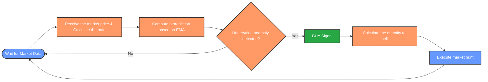

# Mean Reversion Grid Strategy with Hybrid Execution and Forced Capital Deployment (C++ / OCaml / Python)

**A low-latency, microservices-based trading engine designed to automatically detect market price anomalies of a specific stock.**
This project implements a hybrid architecture where execution, strategy logic, and monitoring run as decoupled processes communicating via standard Linux IPC mechanisms.

## Description

### What it does:

It cheks the market price every 30 seconds, it compares it against theoretically correct price. We will take a stochastic model for it. 

#### Market entry
When the price is undervalued (The market prediction is predicting a prive over the real price) it places an order slightly better then the current market price to pay less comissions as it is doing a "market making" order but its true goal is to do market taking. If the order is not taken in 20 seconds. That will be call this "Hidden market making orders", "HiddenMM" to make it short.

#### Market exit
Then, it will place a selling order slightly better then the exiting price in order to free liquid money as soon as possible but keep as most benefit as possible. 

A HiddenMM + a market exit will be called a "Market Hunt".

## System Architecture

The system follows a "Separation of Concerns" principle to maximize stability and minimize latency.

```mermaid
graph TD
    A[Alpaca API] <-->|HTTP/REST| B(C++ Execution Engine);
    B <-->|Linux Pipes| C{OCaml Strategy Brain};
    B -->|Writes JSON| D[Shared Volume / Status File];
    D -->|Reads| E[Python Dashboard];
    E -->|HTML/JS| F[User Browser];
    G[params (json)] -.->|Config| C    
    style B fill:#69f,stroke:#333,stroke-width:2px,color:white
    style C fill:#f96,stroke:#333,stroke-width:2px,color:white
    style F fill:#6c9,stroke:#333,stroke-width:2px,color:white
```

## Core Components

* **Execution Engine (C/C++17):** Handles API connectivity (`libcurl`), order management, and safety checks. Optimized for speed and low overhead.
* **Strategy Core (OCaml):** Pure functional logic for market analysis. Isolated from the network layer to ensure deterministic behavior.
* **Inter-Process Communication:** Uses raw **Linux Pipes (`fork()` + `pipe()`)** to keep latency strictly minimal within the container, between Strategy Core and execution engine.
* **Analytics Dashboard:**
    * Connects to the live data stream.
    * **Automated Statistical Analysis:** Calculates **Sharpe Ratio**, **Max Drawdown**, and **Volatility** in real-time based on the trade history.
    * Provides a responsive UI for monitoring the bot from any device.

## Decision Algorithm (Strategy Core)

Goal: Win as many money as possible.

### The main logic (The Mean Reversion Grid Strategy with Hybrid Execution)

The strategy logic operates on a discretized state space to identify mean-reversion buy opportunities.

1. **Prediction (Signal Processing):** The brain receives the latest market data and calculates the momentum ratio relative to the previous state. Then compares the current ratio against an EMA-based prediction model to filter out noise and detect price anomalies.

2. **Decision (Thresholding):** A trade signal is generated if the divergence between the actual market range and the predicted range exceeds the `MinMargin` parameter. And its only used when it is an undervalue anomaly:
   * **Buy Signal:** Market reality is `MinMargin` or less below prediction. That's a perfect moment to buy (Taker). In case of successfull buy (filled/partially filled) the bot places a selling order at the EMA predicted value (Maker).

3. **Position Sizing (Asymptotic Allocation):** Instead of fixed lot sizes, the system dynamically calculates the optimal position size using a non-linear asymptotic formula. This allows the user to define the strategy, manually depending on the stock, you can define an aggressive entry strategy, that reacts strong at every minimum anomaly, a sniper-style strategy that waits for a big anomaly to take advantage of it with all the budget, or a linear buying one; it all depends on the $level$ value.
   
   The allocation formula is:

   $$SharesAmount(x) = Max \times \left(1 - (1 - x^{level})^{\frac{1}{level}}\right)$$

   *Where:*
   * $x$: The normalized deviation ratio ($CurrentRange / MaxRange$), with $0 \leq x \leq 1$.
   * $Max$: Maximum amount of shares allowed at the operation.
   * $level$: Convexity parameter (customizable in `parameters.txt`).

   **Interactive Visualization:**
   Understand how the `level` parameter affects the capital allocation curve by interacting with the graph below:

   <div align="center" style="margin-left: 15px;">
      <a href="https://www.desmos.com/calculator/lsct6txxp1">
      </a>
   </div>

#### Algorithm Diagram



The problem with ocaml, a normal iteration would generate an infinite stack, avoid that.

## Why an EMA?

To accurately detect market anomalies, the system utilizes a prediction model based on Exponential Smoothing. This approach aligns with the industry standard set by [RiskMetrics (J.P. Morgan)](https://www.msci.com/documents/10199/5915b101-4206-4ba0-aee2-3449d5c7e95a), which validates the use of exponential weighting to address the heteroscedastic nature of financial markets.

Furthermore, the [NIST e-Handbook of Statistical Methods](https://www.itl.nist.gov/div898/handbook/pmc/section4/pmc431.htm) classifies this method as a "short-term memory" model. By mathematically prioritizing new data over older observations, the algorithm effectively reduces the "lag" inherent in trend-following indicators, enabling the precise detection of trend reversals and rapid price shifts.

## Key Engineering Features

1.  **Self-Correcting Order Management:** The C++ engine handles partial fills and network timeouts autonomously without crashing the strategy logic.
2.  **Containerized Security:** Runs in a hardened Docker container with a non-root user. API keys are injected via environment variables, never stored on disk.
3.  **Dynamic Performance Analysis:** Unlike static backtests, the system continuously evaluates its own performance metrics (P&L, Risk Ratios) using the `numpy` engine integrated into the web server.

## Inside the execution engine:

Goals: Lose as less time and mony as possible.

### Algorithm:

1.  Getting data from market.
2.  Sending data to brain.
3.  Waiting answer from brain.
4.  Execute a HiddenMM.
5.  Waiting for 20 seconds or for HiddenMM to finish.
6.  Place a new order for the amount of shares bought at step 5 at the slightly cheaper price respect the prediction.
7.  Chek the status of the orders waiting to be executed. If any is over 12 hours, sell it at market price; if any order has been pulled down from market, rise it again. 
8.  Wait until 30 seconds passed from last time you executed step 1 and execute step 1 again.

## Recomendations:

- Using C++ for the engine is a recomendation, not an obligation, if any language fits better for its purpose, use it.
- Using OCaml for the brain is a recomendation, not an obligation, if any language fits better for its purpose, use it, but it must be so stable and so reliable as possible.
- Using an EMA is a recomendation, not necessary.
- Having the .end at the same directory as the engine is optional.

## Obligations:

- Building a system that runs on its own is mandatory.
- Using alpaca.markets is mandatory.
- Having the credentials of the alpaca api in a .env if mandatory. You can find this document in the same directory as this file.
- Making reliable and minimalist code is mandatory, code shall be as small as possible and as relible as possible.
- Making small code documents is mandatory. It is not permited to build a giant code file, you should split hings into various documents to make it easy to check, test, and escalate.
- It is mandatory that the trading system runs in a docker separated from the rest.
- No port of this computer shall be open to the wait internet as a server, for this project.
- The reporting system shpuld be just a local running html.